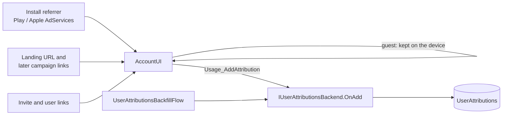
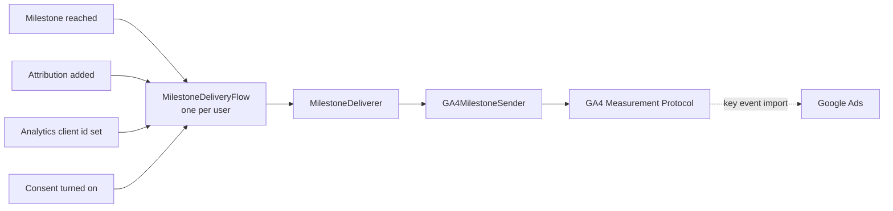

# Attributions and milestones

This page covers three things Voxt keeps per user, all in the Users database:

- **Attributions:** every ad or link that brought the user to the app.
- **Milestones:** the steps that predict whether the user stays.
- **Milestone deliveries:** where each milestone stands with each analytics or ad platform.

The [usage and funnel metrics](./usage-metrics.md) page covers the older `SignUp` arrival, which is still
written as before.

[[toc]]

## Attributions

The client sends what it captured as-is, with an `AttributionOrigin`. The server parses it with
[`AttributionParser`](https://github.com/Actual-Chat/actual-chat/blob/main/src/dotnet/Api/Users/Attribution/AttributionParser.cs).
New fields need no app update, and bad input yields nothing rather than an error.

| Origin | Raw value | Captured |
|---|---|---|
| `Url` | an app URL with campaign parameters: the first one and every later one | every app start and navigation |
| `Referral` | `join:<inviteId>` or `user:<userId>`: an invite link or a user page someone shared | when a guest opens one |
| `PlayReferrer` | the Play install referrer query | once per install |
| `AppleAdServices` | Apple's whole AdServices answer (JSON) | once per install, within Apple's 24 h |
| `LegacySignUp` | the `SignUp` event's `SourceId` | once, for users who signed up before attributions existed |

`Unknown` (0) is never stored.

Parsed fields:

- **Query values:** `utm_source`, `utm_medium`, `utm_campaign` (or `c`) and `utm_term`.
  - The ad group comes from `utm_adgroup`, or `utm_content` when that is not a ValueTrack match type.
  - The match type comes from `utm_matchtype`, or `utm_content` when it is `e`, `p` or `b`.
  - The click id is `gclid`, `gbraid` or `wbraid`.
- **Apple's answer:** `campaignId`, `adGroupId`, `keywordId`, `adId`, `claimType`, `conversionType` and
  `countryOrRegion`.
- **What counts:** an attribution needs a campaign or a click id. A plain organic referrer is not stored.

Rules
([`UserAttributionsBackend`](https://github.com/Actual-Chat/actual-chat/blob/main/src/dotnet/Users.Service/Attribution/UserAttributionsBackend.cs)):

- **Same attribution seen again.** The same platform, campaign, ad group and keyword (`DedupeKey`) is
  not stored twice. Seeing it again moves `FirstSeenAt` back or `LastSeenAt` forward, and a new click id
  replaces the old one.
- **Initial and latest.** `IsInitial` marks the earliest attribution, `IsLatest` the most recent one; a
  user with one attribution has both on the same row. Partial unique indexes allow one of each per user,
  which is why the flags move in two saves.
- **Guests.** A guest's attributions wait in local storage (`Attribution.Pending`) and are sent once the
  user signs in. The device clock is trusted only within the last 90 days.
- **Startup.** The client starts capturing 3 s after the first render, so none of this is on the startup path.

## Milestones

A milestone is reached once per user. If a repeat of the same action is worth more, it becomes a kind of
its own, numbered by suffix (`conversation_2`).
[`UserMilestonesBackend`](https://github.com/Actual-Chat/actual-chat/blob/main/src/dotnet/Users.Service/Milestones/UserMilestonesBackend.cs)
detects them from `ChatEntryChangedEvent` and reads only ids, chat kinds, authors and times. It counts
only a human's posted entry, so it skips:

- system, imported and via-API entries;
- bots, guests and system users;
- a voice entry until the update that ends its stream.

| Kind | Event name | Value | Reached when |
|---|---|---|---|
| `Message` | `message` | 5 | the first post outside the Notes chat |
| `PeerChat` | `peer_chat` | 8 | the first post in a 1:1 chat |
| `Conversation` | `conversation` | 22 | another human is among the authors of the chat's last 64 entries; both sides reach it |
| `Day2Return` | `day2_return` | 38 | posts on two UTC days within 48 h of sign-up; they need not be consecutive |
| `Onboarded` | `onboarded` | — | the `Finished` onboarding step is recorded |

The values come from the early-signals research: each is about the percentage of users who reached the
milestone and were still active on days 60–90.

Each milestone keeps the attribution that was latest when it was reached. Any server code can reach one
with `UserMilestonesBackend_Reach`, which ignores repeats.

## Delivery

[`MilestoneDeliverer`](https://github.com/Actual-Chat/actual-chat/blob/main/src/dotnet/Users.Service/Milestones/MilestoneDeliverer.cs)
goes through every milestone that has not settled with every enabled target, and records the outcome in
`UserMilestoneDeliveries`:

- `AwaitingConsent`: nothing goes out unless the user's `UserAppSettings.IsDataCollectionEnabled` is
  true. Turning it on resumes the flow.
- `Skipped`: the target must never get this milestone, so it counts as delivered. `Note` says why.
- `Pending`: sending failed for a transient reason. It is retried after 1 min, 5 min, 30 min, 2 h and
  12 h, then marked `Failed`.
- `Sent` or `Failed`.

Each target sets its own rules behind `IMilestoneSender`. The GA4 sender:

- skips a milestone with no attribution, or whose attribution was last seen more than
  `GA4Settings.AttributionWindow` (30 days) before it;
- skips a milestone more than 72 h old, which is as far back as the Measurement Protocol accepts;
- waits, checking hourly, for an analytics client id from one of the user's devices. The client sends it
  through `Usage_SetAnalyticsClient` once the user has consented: Firebase's `app_instance_id` in the app,
  GA4's `client_id` on the web;
- posts the event with its value in USD, `ad_user_data: GRANTED` and `ad_personalization: DENIED`, under
  the device seen last.

Google Ads gets these conversions by importing the GA4 key events; nothing calls the Google Ads API.
Apple Ads takes no uploaded conversions, so there is no Apple sender.

::: warning Configuration
A GA4 stream is on only when both its id and its Measurement Protocol API secret are set:

- Android: `UsersSettings:GA4:AndroidFirebaseAppId` and `AndroidApiSecret`
- iOS: `IosFirebaseAppId` and `IosApiSecret`
- Web: `WebMeasurementId` and `WebApiSecret`

With none set, no delivery rows are written.
:::
