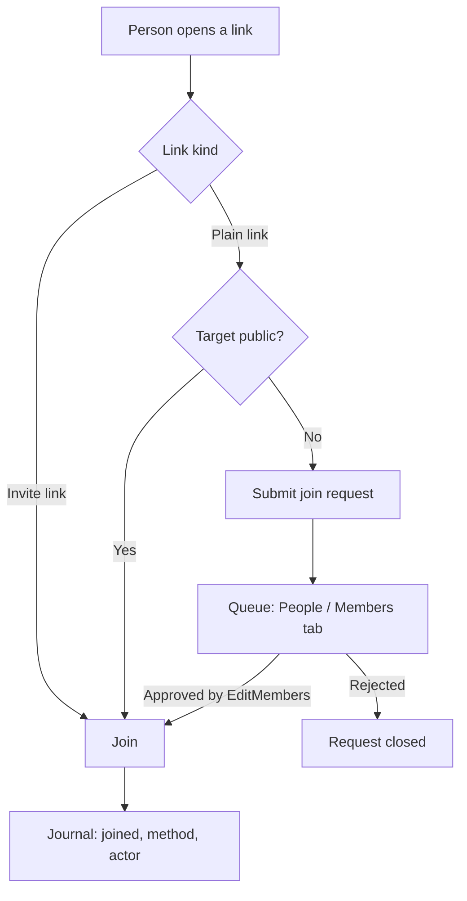

# Place and chat invites

[[toc]]

## Problem

Inviting someone who isn't in your contacts into a place doesn't work today:

- **Share place** copies a plain link to the place. For a private place it leads
  nowhere: a non-member gets no `Join` permission.
- A join link sent into a chat of the place doesn't work either. For a private
  place chat, [InvitesBackend.cs:160-176](https://github.com/Actual-Chat/actual-chat/blob/main/src/dotnet/Invite.Service/InvitesBackend.cs#L160-L176)
  rejects anyone who isn't already a place member ("Only place members can use
  this code."), and non-members only ever get `Read` on place chats
  ([ChatsBackend.cs:1991-1997](https://github.com/Actual-Chat/actual-chat/blob/main/src/dotnet/Chat.Service/ChatsBackend.cs#L1991-L1997)).
- Even a working invite link only writes a grant: `InvitesBackend_Use` stores
  `ChatInviteSettings` in KVAS, and the user then has to press **Join** on the
  chat page ([Authors.cs:177-236](https://github.com/Actual-Chat/actual-chat/blob/main/src/dotnet/Chat.Service/Authors.cs#L177-L236)).

The team mostly talks to people already in their contacts, so this path went
unnoticed. For a new user it's the first thing they hit.

## Decisions

1. **Two ways in, nothing else.** Either an owner adds the person explicitly, or
   the person follows a link. The link path is the same whether or not the person
   is in anyone's contacts, and whoever shared the link doesn't matter.
2. **Following a link** depends only on what the link points to:
   - a public place or chat: the person joins at once;
   - a private one: the person submits a **join request**, which waits in a queue.
3. **Two kinds of link**, clearly told apart in the UI:
   - the **plain link** (what "Share" copies, anyone can pass it on) leads to the
     rule above;
   - the **invite link** created by an owner is pre-approved: the person joins
     even a private place or chat without a request. This is the existing
     `PlaceInvite` / `ChatInvite`, created under `Invite` permission (owner only today).
4. **The queue** is shown on the **People** tab of a place and the **Members** tab
   of a chat. Requests are approved or rejected by anyone with `EditMembers`:
   the owner and the moderator
   ([ChatPermissionsExt.cs:8-12](https://github.com/Actual-Chat/actual-chat/blob/main/src/dotnet/Api/Chat/ChatPermissionsExt.cs#L8-L12)).
   A moderator still can't create invite links or add people directly.
5. **A membership journal** records every join and leave: how and by whom. It's
   stored on the server in full; owners and moderators (`EditMembers`) get a
   filtered view of it. The journal of a place is visible to the place's owner
   and moderators; the journal of a chat, to that chat's owner and moderators -
   a place owner doesn't see a private chat they aren't in.
6. **A private chat inside a place, for someone who isn't a place member**:
   one action, two linked requests, each decided by whoever holds authority over
   it - a chat moderator never lets anyone into the place.
   - Public place: the person joins the place at once; only the chat request
     remains.
   - Private place: the place request goes to the place's owner and moderators.
     The chat request shows up in the chat's queue only once the person is a
     place member, and closes if the place request is rejected.
   - An invite link to such a chat pre-approves the chat only: with a private
     place, the person still queues for the place and enters the chat
     automatically once approved. If the link's creator owns the place, the link
     pre-approves the place too.
7. **One landing page for every link.** It shows what the link leads to ("Alexey
   invites you to *P*") and a single button, which does everything in one
   command:
   - invite link or public target: **Join**, and the person lands in the chat
     already a member - no grant-then-press-Join;
   - plain link to a private target: **Request access** ("you'll be notified");
     for a private chat in a place the person isn't in, the page says it asks for
     both;
   - already a member: no page, straight to the chat.

   Nothing joins on merely opening the link.
8. **Notifications.**
   - A new request: a push to everyone with `EditMembers` on the target, plus the
     unread mark in the list. Several pending requests collapse into one
     notification ("3 new requests in *P*"). Once anyone decides a request, it's
     cleared for the others, the way a read message clears its push.
   - Approved: a push to the requester ("you've been let into *P*") that opens the
     chat.
   - Rejected: no push. The landing page says so if the person opens the link
     again.
9. **Request lifecycle.**
   - One pending request per person and target. Opening the link again shows
     "request sent" and a **Withdraw** button.
   - A pending request expires after 30 days, silently; the landing page then
     offers to ask again.
   - After a rejection the person can ask again in 7 days; until then the landing
     page says the request was rejected and offers no button. An invite link or
     an explicit add lets them in sooner.
   - A former member who was excluded files an ordinary request; the queue row
     marks them as "previously excluded".
10. **Join requests are a property of a private target.** A private place and a
    private chat get `AllowJoinRequests`, changed by anyone with
    `EditProperties` (owner, moderator).
    - On: a plain link leads a non-member to the landing page with **Request
      access**. The card shows only the title and picture - no members, no
      content.
    - Off: a non-member gets the same "not found or no access" page as for an
      address that doesn't exist, so the link doesn't even reveal the target
      exists. Only an invite link or an explicit add gets anyone in.
    - A private chat in a place, for someone outside the place, needs it on for
      both the chat and the place.
    - Proposed default: off for existing private targets (their owners never
      agreed to expose the title and picture), on for new ones. **To be confirmed
      with Alexey on a working demo.**
11. **The share dialog.**
    - **Share** is available to every member and gives the plain link - the place
      or chat address itself, which opens the chat for a member and the landing
      page for anyone else. For a private target it's shown only with
      `AllowJoinRequests` on, captioned "joining needs approval by the owner or a
      moderator".
    - Those with `Invite` (the owner today) also get an **Invite link** row,
      captioned "joins without approval - share only with people you're ready to
      let in", with a **Create** button when there's none yet.
    - No more silent `GetOrGeneratePlaceInvite` / `GetOrGenerateChatInvite`
      ([ShareUIExt.cs:106-120](https://github.com/Actual-Chat/actual-chat/blob/main/src/dotnet/UI.Blazor.App/ShareUIExt.cs#L106-L120)):
      an invite link only appears when someone deliberately creates one.
    - A public place is shared by its own address instead of its welcome chat
      ([ShareUIExt.cs:137-150](https://github.com/Actual-Chat/actual-chat/blob/main/src/dotnet/UI.Blazor.App/ShareUIExt.cs#L137-L150)).
    - The placeholder in the add-member dialog, a bare `Links.PlaceInfo` link
      shown until the share model loads
      ([AddMemberModalPage.razor:49-50](https://github.com/Actual-Chat/actual-chat/blob/main/src/dotnet/UI.Blazor.App/Components/AddMember/AddMemberModalPage.razor#L49-L50)),
      may be what Alexey copied; it becomes a working plain link.
12. **Revoking a leaked invite link** (stage 2). The revoke dialog lists who
    joined through the link, from the journal, with checkboxes and **Revoke and
    exclude selected**; exclusion is the ordinary `Exclude` under `EditMembers`.
    Stage 1 only records the invite id in the journal.

## Design (Grigory)

[Figma: Actual-chat-Desktop, node 27697-223756](https://www.figma.com/design/EJxXOzem02zhRvuqsJIool/Actual-chat-Desktop?node-id=27697-223756):

- Chat or place panel: a collapsible **New requests — N** block above the member
  list, each row with ✕ (reject) and ✓ (approve).
- The **People** tab of the chat list: requests inline, without a collapsible
  block, marked unread, separated by a divider the way a pinned chat is.

## Join flow

## Membership journal

### What exists today

- `DbAuthor` is the membership row for both chats and places (a place member is
  an author of the place root chat, `IsPlaceAuthor`). A rejoin reuses the row
  (unique `ChatId + UserId`, `HasLeft` flag), so fields on it can only hold the
  latest join. `AuthorFull` goes to clients, so nothing private can live there.
- `MembersChangedEntry` is the "X joined / X left" system entry in the chat feed,
  authored by the Walle bot, with no actor or method. It stays as it is.
- `DbInvite` has `CreatedBy` and a `Remaining` counter, but who used an invite is
  never stored.

### Ways a user becomes a member

| Method | Triggered by | Entry point |
|---|---|---|
| Creator | the creator | `Chats_Change` / `Places_Change` create → [ChatsBackend.cs:921](https://github.com/Actual-Chat/actual-chat/blob/main/src/dotnet/Chat.Service/ChatsBackend.cs#L921) |
| Self, public | the user | `Authors_Join` / `Places_Join`, including the implicit join on first post, upload or stream |
| Invite link | the user | `Authors_Join` with a `ChatInviteSettings` grant from `InvitesBackend_Use` |
| Join request approved | owner or moderator | new |
| Added | owner | `Authors_Invite` / `Places_Invite` → [Authors.cs:268](https://github.com/Actual-Chat/actual-chat/blob/main/src/dotnet/Chat.Service/Authors.cs#L268) |
| Restored | `EditMembers` | `Authors_Restore` / `Places_Restore` → [Authors.cs:338](https://github.com/Actual-Chat/actual-chat/blob/main/src/dotnet/Chat.Service/Authors.cs#L338) |
| System | system | new-account auto-joins, peer chats, template clones, copy chat to place, webhook bots, data upgrades |

Leaving: leave, exclude, the place-leave cascade into place chats, bot retirement.

### Recording it

- A new append-only table in `Chat.Service`: chat id, user id, author id, event
  (joined, left, excluded, restored, request submitted / approved / rejected),
  method, actor user id, invite id, time.
- Written inside `AuthorsBackend.OnUpsert`, not in an `AuthorUpsertedEvent`
  handler: several paths upsert with `DoNotNotify` and raise no event.
- The actor and the method are known only at the public command layer, so they
  have to be added to `AuthorsBackend_Upsert`.
- Copy chat to place inserts authors with `dbContext.Authors.Add`
  ([AuthorsBackend.cs:444](https://github.com/Actual-Chat/actual-chat/blob/main/src/dotnet/Chat.Service/AuthorsBackend.cs#L444)),
  bypassing the upsert; it writes its journal rows itself.
- `Authors.OnJoin` reads and deletes the invite grant after the upsert
  ([Authors.cs:226-233](https://github.com/Actual-Chat/actual-chat/blob/main/src/dotnet/Chat.Service/Authors.cs#L226-L233));
  the read moves before it so the invite id reaches the journal.
- The filtered view for owners and moderators shows who, when, how and who let
  them in; internal methods collapse into "added by the system", internal ids
  are left out. It's a separate API method gated by `EditMembers`.
- An invite link gets an optional name, so the journal can say "via link
  *Conference*" rather than "via link #3".

## Stages

Stage 1 is what Alexey wants in the next release; each step below builds on the
ones before it.

1. **Journal.** The table, actor and method on `AuthorsBackend_Upsert`, the copy
   chat path, the invite id read moved before the upsert. It goes first so every
   join from then on is recorded.
2. **Join requests, backend.** `AllowJoinRequests` on places and chats (with the
   migration), the request table, request / withdraw / approve / reject commands
   under `EditMembers`, linked place + chat requests, expiry and the rejection
   pause, notifications.
3. **Links.** The landing page and the routing of plain place and chat addresses,
   one-step join by invite link, the share dialog.
4. **Queue UI.** The requests block on the People and Members tabs and the
   requests in the chat list, after Grigory's design.

Stage 2: the journal view for owners and moderators, and the revoke-and-exclude
dialog.

Stage 1 tasks: [implementation plan](./place-invites-stage1.md).

## Reuse

- `DbInvite`, `InvitesBackend`, `ChatInviteSettings` grants: the invite link.
- `AuthorsBackend_Upsert` / `OnUpsert`: the single place every join goes through.
- `ChatPermissions.EditMembers`, `SystemRole.Moderator`: who handles the queue.
- `EditChatMemberCommands` / `EditPlaceMemberCommands`: the member list UI the
  queue sits on.
